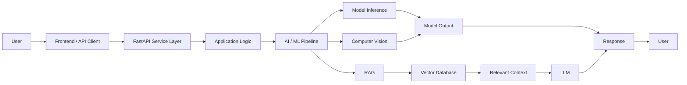

<div align="center">


<br/>

<a href="https://www.linkedin.com/in/shivanand-devakate">
  
</a>
<a href="https://github.com/shivanand-1">
  
</a>
<a href="https://shivanand-1.netlify.app">
  
</a>
<a href="mailto:shivananddevakate497@gmail.com">
  
</a>

<br/><br/>


</div>

---

## About Me

I build **AI and data-driven applications** that connect machine learning models with backend systems and usable product interfaces.

My work focuses on:

* **Generative AI & RAG** — document ingestion, embeddings, semantic retrieval and LLM applications
* **Computer Vision** — object detection and model inference pipelines
* **Machine Learning** — predictive modeling, feature engineering and model evaluation
* **Backend Engineering** — FastAPI, REST APIs and database-integrated AI services
* **Data Engineering for ML** — preprocessing, transformation and model-ready pipelines

I hold a **B.E. in Computer Science & Engineering (VTU)** and work across the complete path from **data and models to APIs and applications**.

> **Engineering mindset:** A model becomes useful when it can be integrated into a reliable system.

---

## Engineering Profile

```python
class ShivanandDevakate:
    role = "AI Engineer / Data Scientist"
    location = "Bengaluru, India"

    focus = [
        "RAG Systems",
        "Generative AI",
        "Computer Vision",
        "Machine Learning",
        "FastAPI Backends"
    ]

    stack = [
        "Python",
        "FastAPI",
        "LangChain",
        "PyTorch",
        "TensorFlow",
        "PostgreSQL"
    ]

    building = [
        "AI-powered applications",
        "ML inference services",
        "Retrieval pipelines",
        "Data-driven APIs"
    ]

    philosophy = "Build models into systems, not isolated experiments."
```

---

## Technical Stack

### Languages

<p>
  
</p>

### AI / Machine Learning

<p>
  
  
  
</p>

### Generative AI

<p>
  
  
  
  
  
</p>

### Computer Vision

<p>
  
  
</p>

### Backend & APIs

<p>
  
  
</p>

### Data

<p>
  
  
  
  
</p>

### Databases & Storage

<p>
  
  
</p>

### DevOps & Developer Tools

<p>
  
</p>

---

## ⚙️ How I Build AI Systems

I approach AI applications as **software systems**, not only model-training notebooks.



**Design approach**

* Keep API boundaries predictable.
* Separate business logic from inference logic.
* Treat retrieval and model inference as independent components.
* Keep persistence separate from model execution.
* Build systems so individual components can be replaced without rewriting the entire application.

---

# Featured Projects

## 🧠 AI-Powered RAG Knowledge System

**Problem**

Static documents can be difficult to search when users need a direct answer based on the available source material.

**Solution**

A retrieval-augmented knowledge system that ingests documents, creates semantic representations, retrieves relevant information and provides context-aware responses through an API.

**Engineering**

```text
Documents
   ↓
Document Ingestion
   ↓
Text Splitting
   ↓
Embeddings
   ↓
ChromaDB
   ↓
Semantic Retrieval
   ↓
Relevant Context
   ↓
LLM
   ↓
Grounded Response
```

**Stack**

`LangChain` `FastAPI` `ChromaDB` `Groq` `Embeddings`

**Key Engineering Concepts**

`RAG` · `Vector Search` · `Embeddings` · `Semantic Retrieval` · `LLM Integration` · `REST API`

---

## 🍎 AI Nutrition Detection System

**Problem**

Manual food logging requires users to identify food items and estimate quantities before nutritional information can be recorded.

**Solution**

A computer-vision pipeline designed to identify food items from images, estimate quantity and map detected items to nutritional information through an API-based application.

**Engineering**

```text
Image
   ↓
Preprocessing
   ↓
YOLOv8
   ↓
Food Detection
   ↓
Quantity Estimation
   ↓
Nutrition Mapping
   ↓
FastAPI
   ↓
Result
```

**Stack**

`YOLOv8` `FastAPI` `OpenCV` `Python`

**Key Engineering Concepts**

`Object Detection` · `Model Inference` · `Image Processing` · `API Integration` · `Data Mapping`

---

## 🎥 YouTube Video RAG Summarizer

**Problem**

Long-form video content can be difficult to review when the goal is to quickly find specific information or understand the main concepts.

**Solution**

A pipeline that extracts video audio/transcripts, performs transcription with Whisper, processes the resulting text and uses retrieval-augmented generation for summarization and question answering.

**Engineering**

```text
YouTube URL
   ↓
Audio / Transcript Extraction
   ↓
Whisper
   ↓
Text Processing
   ↓
Chunking
   ↓
Embeddings
   ↓
Vector Retrieval
   ↓
LLM
   ↓
Summary / Q&A
```

The system also supports **Hindi-to-English transcription** through the transcription pipeline.

**Stack**

`Whisper` `yt-dlp` `LangChain` `RAG`

**Key Engineering Concepts**

`Speech-to-Text` · `Text Processing` · `RAG` · `Vector Search` · `LLM Integration`

---

## 💊 MediSense AI

**Problem**

Drug-interaction checking can require users to work through information from multiple sources.

**Solution**

An AI application combining an **XGBoost classification model** with a full-stack **FastAPI + React** application and PostgreSQL/ChromaDB storage.

**Engineering**

```text
User
  ↓
React Application
  ↓
FastAPI
  ↓
Application Logic
  ↓
XGBoost Model
  ↓
PostgreSQL / ChromaDB
  ↓
Result
```

**Stack**

`XGBoost` `FastAPI` `React` `PostgreSQL` `ChromaDB`

**Key Engineering Concepts**

`Model Inference` · `REST API` · `Database Integration` · `Full-Stack Integration`

---

## 🌾 AgriContract

**Problem**

Agricultural workflows can involve disconnected crop recommendations, soil analysis, disease prediction and buyer interactions.

**Solution**

An agritech platform combining crop recommendation, soil analysis and disease prediction with blockchain-backed contracts intended to connect farmers directly with buyers.

**Engineering**

```text
Agricultural Data
       ↓
Data Processing
       ↓
ML Models
       ↓
Crop / Soil / Disease Insights
       ↓
FastAPI
       ↓
Application Layer
       ↓
Buyer / Farmer Workflow
```

**Stack**

`Python` `FastAPI` `Machine Learning`

**Key Engineering Concepts**

`Predictive Modeling` · `Data Processing` · `API Integration` · `Application Architecture`

---

## 🏠 Bengaluru House Price Prediction

**Problem**

Property prices in Bengaluru vary across locations and property characteristics, making consistent estimation a data-driven modeling problem.

**Solution**

A regression-based machine learning system using feature engineering and multiple algorithms to estimate property prices.

**Engineering**

```text
Raw Housing Data
      ↓
Data Cleaning
      ↓
Feature Engineering
      ↓
Model Training
      ↓
Model Comparison
      ↓
Evaluation
      ↓
Price Prediction
```

**Stack**

`Python` `Pandas` `Scikit-learn` `Regression`

**Key Engineering Concepts**

`Feature Engineering` · `Regression` · `Model Evaluation` · `Data Processing`

---

<div align="center">

<a href="https://github.com/shivanand-1">
  
</a>
<a href="https://shivanand-1.netlify.app">
  
</a>

</div>

---

## 🧩 Engineering Principles

| Principle                         | What it means                                                                       |
| --------------------------------- | ----------------------------------------------------------------------------------- |
| **Build before over-engineering** | Start with a working system and introduce complexity when the problem requires it.  |
| **Keep APIs predictable**         | Clear contracts make AI services easier to consume and maintain.                    |
| **Separate responsibilities**     | Keep data processing, business logic and inference independently organized.         |
| **Prefer measurable results**     | Use evaluation and observable behavior instead of assumptions.                      |
| **Design ML for integration**     | Models should fit into applications and workflows, not remain isolated experiments. |
| **Write maintainable software**   | Code should remain understandable when someone else has to extend it.               |

---

## Currently Building

```text
→ Production-oriented RAG systems
→ FastAPI services around ML and Computer Vision models
→ Computer Vision inference pipelines
→ LLM-powered applications
→ ML model integration
→ Data-driven APIs
```

---

## 📊 GitHub Analytics

<div align="center">


<br/>


<br/>


</div>

---

## 🏆 Certifications

| Certification           | Issuer                  |
| ----------------------- | ----------------------- |
| Data Science Internship | **QSpiders**            |
| Data Preprocessing & ML | **YHills**              |
| Data Science            | **Infosys Springboard** |
| Data Science            | **CodeWithHarry**       |

---

## Connect

<div align="center">

### Interested in building AI-powered products or data-driven systems?

<br/>

<a href="https://www.linkedin.com/in/shivanand-devakate">
  
</a>

<a href="https://github.com/shivanand-1">
  
</a>

<a href="https://shivanand-1.netlify.app">
  
</a>

<a href="mailto:shivananddevakate497@gmail.com">
  
</a>

<br/><br/>

**Python · AI/ML · GenAI · RAG · Computer Vision · FastAPI**

</div>

<br/>

<div align="center">


</div>
