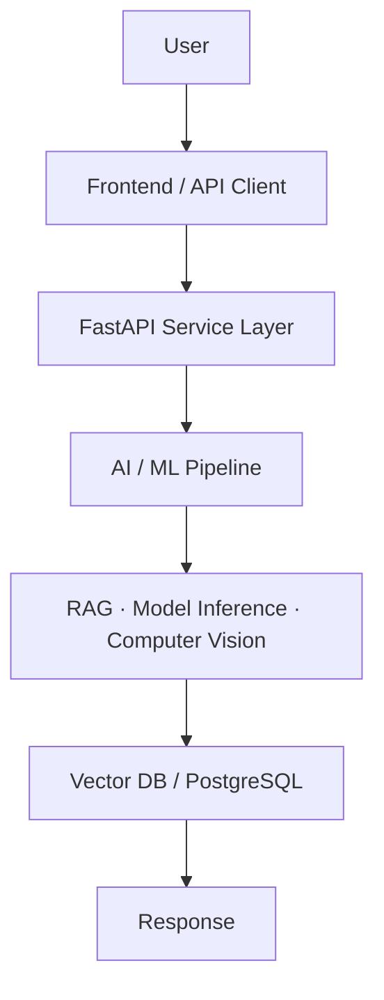
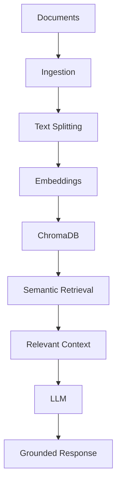
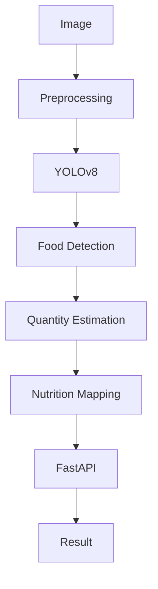
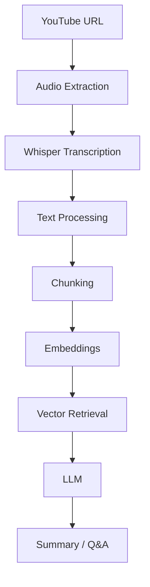

<div align="center">


<a href="https://www.linkedin.com/in/shivanand-devakate"></a>
<a href="https://github.com/shivanand-1"></a>
<a href="https://shivanand-1.netlify.app"></a>
<a href="mailto:shivananddevakate497@gmail.com"></a>

<br/><br/>


</div>

<br/>

## About Me

I build AI and data-driven applications that connect machine learning models with production-oriented backend systems. My work spans Retrieval-Augmented Generation, computer vision inference, and predictive modeling — each shipped as a working API rather than a notebook experiment.

I hold a B.E. in Computer Science & Engineering (VTU) and currently work as a freelance Data Scientist / AI Engineer based in Bengaluru, India, building end-to-end systems: FastAPI service layers, vector-store-backed retrieval, and ML pipelines wired into usable products.

<br/>

## Engineering Profile

```python
class ShivanandDevakate:
    role        = "AI Engineer / Data Scientist"
    location    = "Bengaluru, India"
    focus       = ["RAG Systems", "Computer Vision", "FastAPI Backends", "Predictive ML"]
    stack       = ["Python", "FastAPI", "LangChain", "PyTorch", "TensorFlow", "PostgreSQL"]
    building    = "Production-oriented AI services, one pipeline at a time"
    philosophy  = "A model isn't done until it's behind an API"
```

<br/>

## Tech Stack

**Languages**
<br/>


**AI / Machine Learning**
<br/>

<br/>
 

**Generative AI**
<br/>
   

**Computer Vision**
<br/>
 

**Backend**
<br/>
 

**Data**
<br/>
   

**Databases**
<br/>
 

**DevOps / Tools**
<br/>


<br/>

## ⚙️ How I Build AI Systems



Every project follows this shape: a thin, predictable API in front, the model or retrieval logic isolated in its own layer, and persistence handled separately from inference — so components can be swapped without rewriting the system.

<br/>

## Featured Projects

### 🧠 AI-Powered RAG Knowledge System

**Problem:** Static documents are hard to query — users need direct, grounded answers instead of manually searching through files.

**Solution:** A retrieval-augmented question-answering service that ingests documents, indexes them for semantic search, and answers queries with context pulled from the source material.

**Engineering:** Document ingestion → chunking → embedding generation → vector storage in ChromaDB → semantic retrieval → context-augmented LLM response, exposed through a FastAPI layer.



**Stack:** `LangChain` `FastAPI` `ChromaDB` `Groq` `Embeddings`

**Key Engineering Concepts:** RAG · Vector Search · Embeddings · API Integration

---

### 🍎 AI Nutrition Detection System

**Problem:** Manually logging food intake and nutrition is tedious and error-prone.

**Solution:** A computer-vision pipeline that detects food items from an image, estimates portion size, and maps detections to nutritional data — served through a FastAPI endpoint.



**Stack:** `YOLOv8` `FastAPI` `OpenCV`

**Key Engineering Concepts:** Object Detection · Model Inference · API Integration

---

### 🎥 YouTube Video RAG Summarizer

**Problem:** Long-form video content is time-consuming to review for specific information.

**Solution:** Extracts and transcribes video audio (including Hindi-to-English transcription via Whisper), then enables retrieval-augmented Q&A and summarization over the transcript.



**Stack:** `Whisper` `yt-dlp` `LangChain` `RAG`

**Key Engineering Concepts:** Speech-to-Text · RAG · Vector Search · Data Processing

---

### 💊 MediSense AI

**Problem:** Checking for drug interactions manually is slow and easy to get wrong.

**Solution:** A drug-interaction checker combining an XGBoost classification model with a full-stack FastAPI + React application, using hybrid PostgreSQL and ChromaDB storage.

**Stack:** `XGBoost` `FastAPI` `React` `PostgreSQL` `ChromaDB`

**Key Engineering Concepts:** Model Inference · REST API · Database Integration

---

### 🌾 AgriContract

**Problem:** Farmers often lack direct, transparent access to buyers and agronomic guidance.

**Solution:** An agritech platform combining crop recommendation, soil analysis, and disease prediction with blockchain-backed contracts connecting farmers directly to buyers.

**Stack:** `Python` `FastAPI` `Machine Learning`

**Key Engineering Concepts:** Predictive Modeling · API Integration · Data Processing

---

### 🏠 Bengaluru House Price Prediction

**Problem:** Real estate pricing in Bengaluru varies widely and is hard to estimate consistently.

**Solution:** A regression-based pricing model with feature engineering, trained and compared across multiple algorithms to estimate property prices.

**Stack:** `Scikit-learn` `Pandas` `Regression`

**Key Engineering Concepts:** Feature Engineering · Model Evaluation · Data Processing

<div align="center">

*More projects on <a href="https://github.com/shivanand-1">GitHub</a> and in my <a href="https://shivanand-1.netlify.app">portfolio</a>.*

</div>

<br/>

## 🧩 Engineering Principles

- Build before over-engineering
- Keep APIs predictable
- Separate data, business logic, and inference
- Prefer measurable results over assumptions
- Design ML systems for integration, not isolation
- Write software that can be maintained by someone else

<br/>

## Currently Building

- Production-oriented RAG systems
- FastAPI services around ML and CV models
- Computer vision inference pipelines
- Data-driven APIs for real-world use cases

<br/>

## 📊 GitHub Analytics

<div align="center">


</div>

<br/>

## 🏆 Certifications

| Certification | Issuer |
|---|---|
| Data Science Internship | QSpiders |
| Data Preprocessing & ML | YHills |
| Data Science | Infosys Springboard |
| Data Science | CodeWithHarry |

<br/>

## Connect

<div align="center">

**Interested in building AI-powered products or data-driven systems?**

<a href="https://www.linkedin.com/in/shivanand-devakate"></a>
<a href="https://github.com/shivanand-1"></a>
<a href="https://shivanand-1.netlify.app"></a>
<a href="mailto:shivananddevakate497@gmail.com"></a>

<br/><br/>


</div>
